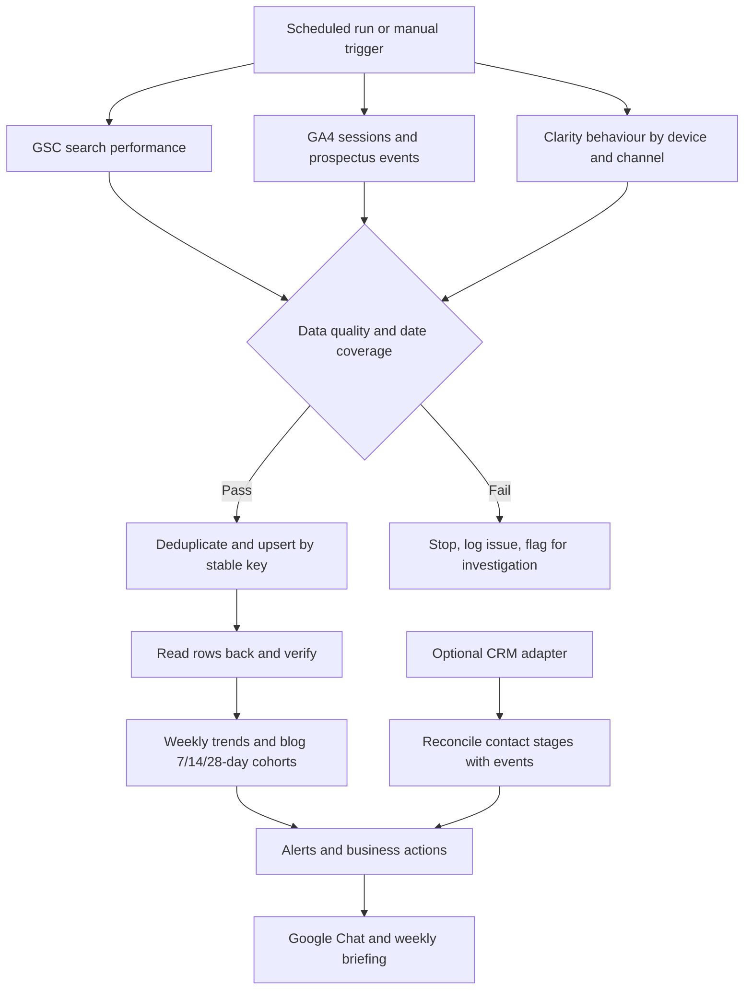

# SEO Operations Automation: From Search Data to Decisions

**An end-to-end, runnable n8n portfolio case study by Grace Odukoya**

> **Business objective:** Cut recurring SEO reporting work, catch drops and website friction earlier, and give marketing teams clear actions tied to prospectus enquiries.

**See it working:** This repository includes an importable n8n workflow, synthetic source data, an optional Python command-line replay, **41 automated quality checks**, and an exact expected output. No paid services, secrets or external accounts are needed for the demo.

## What problem does it solve?

A marketing team running an online education website needs to answer three questions every week:

1. **Are people finding us?** Search clicks, search visibility, traffic by page and search query.
2. **Are visits turning into enquiries?** Prospectus form event trends, with proper measurement caveats.
3. **Where are we losing visitors?** Dead clicks, rage clicks, quickbacks and script errors by device and traffic channel.

Manually exporting data from separate platforms can delay decisions, allow duplicate or incomplete rows into reports, and hide a problem until someone looks for it.

I designed an SEO operations pipeline that collects, checks, stores, compares and explains the data. The output is a prioritized list of actions, with an audit trail.

## How it works



**Production patterns demonstrated:** GSC + GA4 + Microsoft Clarity, Google Sheets idempotent upserts, read-back verification, blog cohort tracking, scheduled alerts, Google Chat reporting and an error-handler workflow. The CRM bridge in this public demo is **simulated** because a live CRM account was unavailable.

## Try the automation in 2 minutes

**Option A: See the real n8n workflow logic.**

1. Download [`workflows/n8n-import-demo.json`](workflows/n8n-import-demo.json).
2. In your own n8n workspace, create a blank workflow, then choose **Import from File**.
3. Open **START | Run Synthetic End-to-End Demo**, click **Test workflow**.
4. Inspect node **09 | Publish Decision-Ready Demo Output**. You will see validated KPIs, a CRM reconciliation diagnostic, Clarity friction flags, blog cohort statuses, simulated Google Sheets read-back and suggested decisions.

This import is deliberately **credential-free**. It runs entirely on included fictional inputs. It never sends messages, reaches a client website or changes external data.

**Option B: Run the same calculations in Python (standard library only).**

```bash
python -m src.pipeline --input examples/demo_input.json
python -m unittest discover -s tests -v
```

For a local replay of the n8n Code nodes without opening n8n:

```bash
node scripts/replay_n8n_demo.js
```

No dependency installation is required for the Python replay. A recent Node.js installation is needed only for the optional JavaScript replay.

**Bonus: A real HTTP integration test with a fictional CRM API.**

```bash
python -m src.crm_http_demo
```

This starts a temporary server on your own computer, fetches **62 mock contacts over four HTTP pages**, maps and deduplicates the results, then shuts down. It proves actual HTTP transport and pagination in a safe environment. It does not claim access to a client CRM.

## What the sample proves

<details>
<summary>See the synthetic demo's results</summary>

| Signal | Previous week | Current week | Action |
|---|---:|---:|---|
| Organic search clicks | 1,600 | 1,200 (**-25%**) | Review affected pages, rankings, demand and indexing |
| GA4 prospectus form events | 130 | 84 (**-35.4%**) | Check form flow and event instrumentation |
| Organic mobile sessions with dead clicks | 10% | 19% (**+9 percentage points**) | Review recordings, clickable elements and CTA behaviour |
| Paid mobile sessions with dead clicks | 25% | 32% (**+7 percentage points**) | Inspect conversion friction in mobile landing journeys |
| Mock CRM contacts | | 62 fictional unique contacts | Investigate relationship to 84 GA4 event occurrences |

**All numbers in this table are invented for reproducible testing.** They are not a client's growth, losses or financial impact.

</details>

## Why this is more than a reporting script

| Engineering choice | Business benefit |
|---|---|
| Reject missing and non-final search dates | Prevents misleading trends from incomplete exports |
| Accept identical retries, reject conflicting duplicates | Keeps the historical report clean |
| Check for API row caps and missing metrics | Prevents a partial report from being marked successful |
| Read stored records back after a write | Proves that the data really landed in the destination |
| Track blog posts after 7, 14 and 28 days | Shows which content gains traction and which needs optimization |
| Compare Clarity **session incidence percentages** | Distinguishes user friction from raw click counts |
| Separate GA4 event occurrences from unique CRM contacts | Prevents inflated lead and ROI claims |
| Send exceptions and decisions to a team channel | Shortens the time between detection and a fix |

## The business outcome

The goal is to **reallocate reporting time toward SEO fixes and landing-page improvements**. An example capacity model assumes five hours of weekly manual compilation and one hour of QA after automation, freeing **four hours per week**. This is an illustrative assumption in the sample fixture. I have **not** measured or claimed actual hours saved or revenue generated for the underlying private deployment.

The more important improvement is reliability: each report can be traced to a dated source response, a unique storage key and a verification outcome. A failed check blocks success.

## What is production-validated, and what is simulated?

- **Production work, private:** I designed, configured and manually validated a multi-workflow SEO monitoring system using authenticated GSC, GA4 and Clarity APIs, Google Sheets writes and read-back checks, blog performance cohorts and Google Chat delivery. Client identifiers, source exports, credentials, live workflow URLs, screenshots and operational results are intentionally excluded from this public repository.
- **This public repository:** A safe, independently runnable reconstruction of the decision rules and reliability controls using generated data. Python and n8n replays can be tested by anyone.
- **CRM connection:** The demo uses a fictional CRM fixture with unique contact IDs and lead stages. No live GoHighLevel or other CRM API connection is claimed here. The adapter contract is documented in [`docs/integrations.md`](docs/integrations.md).
- **Financial impact:** No actual revenue uplift, time saving or lead-to-enrolment improvement is claimed without measurement.

## Where to look if you're hiring

**Five-minute review path:** [Interview demo guide](docs/interview-demo.md) → [`n8n-import-demo.json`](workflows/n8n-import-demo.json) → [QA evidence](docs/quality-and-evidence.md) → [sample output](examples/demo_output.json).

For engineers: read [`src/pipeline.py`](src/pipeline.py), the [automated tests](tests/test_pipeline.py), [integration contracts](docs/integrations.md), and the [automated GitHub Actions check](.github/workflows/qa.yml).

## Project files

| Path | What you can inspect |
|---|---|
| `workflows/n8n-import-demo.json` | Importable, credential-free end-to-end automation |
| `src/pipeline.py` | Full data validation, comparison, storage QA, Clarity and CRM diagnostic logic |
| `src/crm_http_demo.py` | Local mock CRM HTTP API and paginated client with integration tests |
| `tests/` | Failure-mode and business-rule tests |
| `examples/` | Fictional inputs and deterministic outputs |
| `docs/interview-demo.md` | Simple live demonstration script |
| `docs/integrations.md` | Real-connector architecture and CRM integration boundary |
| `docs/quality-and-evidence.md` | What is verified and what cannot be claimed |
| `docs/privacy.md` | How the public package was sanitized |
| `docs/business-measurement.md` | How to measure real hours saved and performance outcomes |
| `docs/publish-to-github.md` | How to put this package into its own public GitHub repository |
| `.github/workflows/qa.yml` | Automated test and secret-scan checks |

**Author:** Grace Odukoya · SEO Automation / Marketing Operations · Python, n8n, GSC, GA4, Clarity, Google Sheets, Google Chat
